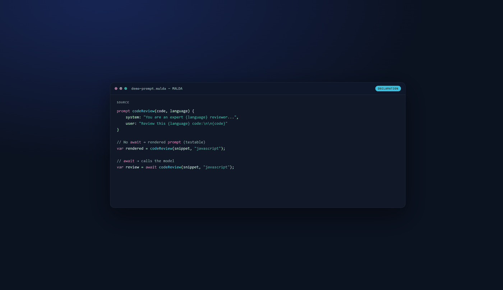
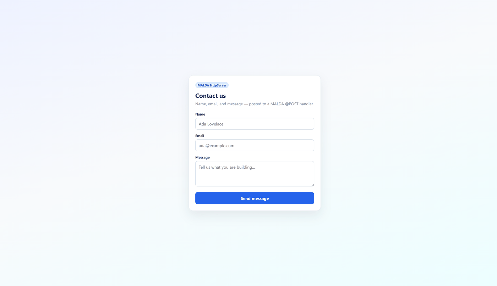
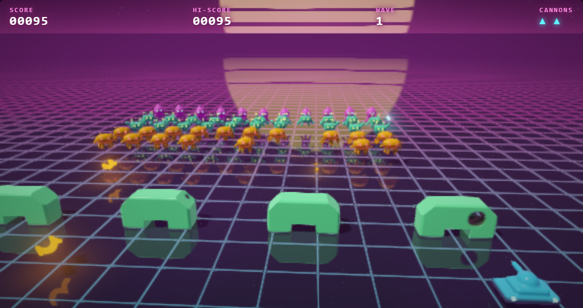

# MALDA™

[](https://github.com/amaldini/maldalang/actions/workflows/ci.yml)
[](https://github.com/amaldini/maldalang/releases)
[](#license)

**MALDA** (Multi Agent Language with Development Automation) is an AI-native programming language and platform for agents, web apps, durable workflows, and browser apps and games. The automation in the name runs both ways: coding agents write MALDA — the language pack in [`docs/llm/`](docs/llm/) exists for that reader — and MALDA programs automate development work in turn.

This repository is the **open-source core**: language runtime, compiler/transpiler, IDEs, language server, examples, templates, and reference manual.

Language reference: [English](https://amaldini.github.io/maldalang/) · [Italiano](https://amaldini.github.io/maldalang/it/)

## MALDA in one file

Verbatim from [`Examples/Basics/first_look.malda`](Examples/Basics/first_look.malda). Runs offline, no API key:

```malda
schema Review {
    summary: string;
    issues: string[];
}

prompt codeReview(code, language) -> Review {
    system: "You are an expert reviewer of {language}.",
    user: "Review this {language} code:\n\n{code}"
}

var rendered = codeReview("function add(a, b) { return a + b; }", "javascript");
io.print(rendered.user);

var checked = validate("Review", {
    "summary": "Looks fine",
    "issues": []
});
if (checked.ok) {
    io.print("schema ok: " + checked.data.summary);
} else {
    io.print("schema failed: " + checked.error);
}
```

```bash
malda Examples/Basics/first_look.malda
```

- `-> Review` binds the prompt to the schema.
- Without `await`, calling the prompt returns the rendered template; `await` calls the model
  and validates its JSON against `Review`.
- `validate("Review", …)` is that same check, shown offline. Type annotations elsewhere are
  IDE/LSP hints, not runtime checks.



*`prompt` is syntax: without `await` you get the rendered prompt; with `await` you call the model.*



*Contact form on `HttpServer`: fill fields, `@POST /submit`, thank-you page (`Examples/ui_contact_form.malda` pattern).*



*[`Examples/Games/three_sdf_invaders.malda`](Examples/Games/three_sdf_invaders.malda): a 3D game drawn by one `@shader()` raymarcher, compiled to JavaScript and GLSL. Run it with `malda play`.*

## Features

- **Language & runtime** — objects, functions, actors, exceptions, namespaced standard library (`io` / `math` / `str`)
- **Three backends, documented overlap** — interpret for iteration; transpile to a .NET executable; compile to JavaScript for the browser. Agents, prompts, HTTP servers, file I/O and workflows stay on the host backends. Matrix: [`docs/spec/backend-capability-matrix.md`](docs/spec/backend-capability-matrix.md)
- **AI** — `prompt` declarations, agents, tools, MCP
- **Web** — REST decorators and `@PAGE` / `@AIPAGE` on the host runtime; `ui.*` controls, served by a UI host that is secure by default or run in the page with no host. Notes: [`docs/ui-framework.md`](docs/ui-framework.md)
- **Browser apps** — the JavaScript backend emits scripts or ES modules (`--minify` optional) and has `import js` interop with existing libraries, `buf.*` typed buffers, `@worker()` actors on Web Workers, client-side `ui.*`, a persistent `io.store*` on IndexedDB, and browser file calls. Notes: [`docs/javascript-backend.md`](docs/javascript-backend.md)
- **Games and graphics** — a `game.*` canvas kit, `three.*` 3D, and `@shader()` functions compiled to GLSL; `malda play <file>` compiles and serves one. Samples: [`Examples/Games`](Examples/Games)
- **Neural nets** — a from-scratch track from the perceptron to attention, on `nn.*` and `math.matmul`, with layer classes that run on all three backends. Offline, no API key. Guide: [`docs/start-here.md`](docs/start-here.md). Manual: [chapter 14](ReferenceManual/14-neural-nets.html)
- **Workflows** — durable `step` / retry / compensate on local SQLite (single writer, not a cluster)
- **Types** — annotations feed the IDE/LSP (mismatches are Errors by default in the editor); runtime stays dynamic. `malda compile --mode transpile` / `publish` refuses emit on those Errors (`--lenient-types` to skip)
- **Tooling** — Desktop IDE (Windows reference), Web IDE (browser playground — not Desktop parity), VS Code + LSP, `malda fmt` / `lint` / `test`, and a debug adapter (`malda debug-adapter`) for interpreted programs

**What this is not:** a Temporal cluster, a full static type system, or three equal backends. Workflows are local SQLite (single writer). JavaScript runs browser programs, not the host features (agents, HTTP servers, workflows). Spec Final 1.0 is the language kernel; the toolchain is on the 1.0.x line (publish is the type boundary) — current version on [Releases](https://github.com/amaldini/maldalang/releases).

The largest showcases were written entirely by coding agents, even though MALDA is in no
model's training data, because [`docs/llm/`](docs/llm/) ships a compact language pack for that
reader: **`Examples/Agents/secondbrain_semantic.malda`** (~7,600 lines with shared libs),
**`Examples/RalphWiggum/`** (~4,300 lines), and the games in
[`Examples/Games`](Examples/Games) (~32,000 lines; the largest,
**`three_shader_race_traffic.malda`**, is ~5,800). Guard tests, the conformance matrix, and executed
reference-manual snippets keep those claims checkable.

Longer version, with objections and current weaknesses stated up front:
[`docs/announcement.md`](docs/announcement.md).

## Requirements

- [.NET 8 SDK](https://dotnet.microsoft.com/download/dotnet/8.0) if you build from source
- Windows for Desktop IDE (WPF); CLI, Web IDE, and VS Code extension work cross-platform where .NET 8 does

## Install without cloning the sources

GitHub Releases ship **self-contained zips** (no separate .NET install needed).
On Windows the win-x64 zip is the install: unzip and run `MaldaDesktop.bat`.

1. Open [Releases](https://github.com/amaldini/maldalang/releases) and download
   `malda-<version>-win-x64.zip` or `malda-<version>-linux-x64.zip`.
2. Unzip, then:

```bash
# Windows — Desktop IDE (the Windows install; included in the win-x64 zip)
MaldaDesktop.bat

# Windows — CLI
malda.bat Examples\Basics\first_look.malda
# or: bin\malda\malda.exe Examples\Basics\first_look.malda

# Linux — CLI only (no WPF Desktop IDE)
./malda Examples/Basics/first_look.malda
```

The archive also includes `Examples/`, the HTML `ReferenceManual/`, `Templates/`
(for `malda new`), the language pack under `docs/llm/`, `docs/spec/`, and dual-licence
files. Point coding agents at `AGENTS.md` (then `docs/llm/`) so they can write `.malda`
programs without the git sources. Optional: add `bin/malda` to your `PATH`.

To rebuild those zips locally:

```bash
# Windows (CLI + Desktop IDE)
build_malda_distribution.bat
# or: powershell -File scripts/build-oss-dist.ps1 -Runtime all
```

Tagged releases (`v*`) build the zips in CI via `.github/workflows/release.yml`.

## Quick start (from source)

```bash
git clone https://github.com/amaldini/maldalang.git
cd maldalang
dotnet build MaldaLang.sln
dotnet run --project MaldaLang -- Examples/Basics/first_look.malda
```

On **Linux and macOS**, build the projects instead of the solution — `MaldaLang.sln`
includes the WPF Desktop IDE, which targets `net8.0-windows` and cannot build elsewhere:

```bash
dotnet build MaldaLang
dotnet build MaldaLang.Compiler
dotnet build MaldaLang.LanguageServer
dotnet build MaldaLang.IDE
dotnet run --project MaldaLang -- Examples/Basics/first_look.malda
```

Or build a reusable CLI output:

```bash
# Build the compiler project: it also builds the CLI and puts MaldaLang.Compiler.dll beside it.
# (`dotnet build MaldaLang -o …` would leave a stale compiler DLL there.)
dotnet build MaldaLang.Compiler -o artifacts/malda-cli
# Windows: malda.exe — Linux/macOS: malda
artifacts/malda-cli/malda Examples/Basics/first_look.malda
```

Compile to an executable:

```bash
dotnet run --project MaldaLang -- compile Examples/Basics/first_look.malda --mode transpile -o first-look.exe
```

## LLM access (optional)

Core language examples such as `first_look.malda` and `hello_world.malda` need **no API key**
and make **no network calls**.

AI features (`prompt`, agents, `@AIPAGE`, and similar) use, in order:

1. **OpenRouter** when `OPENROUTER_API_KEY` is set (or `providers.openrouter.apiKey` in
   `~/.malda/config.json`).
2. Otherwise a **local GGUF fallback**: on first use MALDA downloads
   [`qwen2.5-0.5b-instruct-q4_k_m.gguf`](https://huggingface.co/Qwen/Qwen2.5-0.5B-Instruct-GGUF)
   (~500 MB) from Hugging Face into the local app-data cache
   (`%LOCALAPPDATA%\MaldaLang\Models\default` on Windows). That model proves the pipeline
   offline; it is not a production-quality chat model.

To prefetch the local model deliberately:

```bash
dotnet run --project MaldaLang -- onboard --download-local-llama
```

## IDEs and editors

These are **not** the same product surface:

| Tool | Role | Best for |
|------|------|----------|
| **Desktop IDE** (`MaldaLang.DesktopIDE`) | Full Windows IDE | Daily development: multi-file/`include`, virtual `@malda-section` tabs, local models, MCP, UIHost preview, richer compile |
| **Web IDE** (`MaldaLang.IDE`) | Browser learning playground | Try examples, edit/run/debug in Monaco from any OS — **not** feature-parity with Desktop |
| **VS Code + LSP** (`vscode-malda`, `MaldaLang.LanguageServer`) | Cross-platform editor integration | Serious editing outside the Desktop IDE |

```bash
# Web IDE (browser playground)
dotnet run --project MaldaLang.IDE
# then open the printed https://localhost:... URL

# Desktop IDE (Windows)
dotnet run --project MaldaLang.DesktopIDE
```

Community help on the Web IDE (Monaco UX, diagnostics, examples browser) is welcome; Desktop remains the reference IDE.

## Learn more

| Path | Purpose |
|------|---------|
| [`AGENTS.md`](AGENTS.md) | Map for humans and coding agents |
| [`docs/llm/`](docs/llm/) | Compact pack for writing `.malda` programs |
| [`docs/architecture.md`](docs/architecture.md) | Pipeline, projects in the solution, where to edit |
| [`docs/start-here.md`](docs/start-here.md) | Guided onboarding |
| [`llms.txt`](llms.txt) | Compact doc index for LLM tools |
| [`docs/releases/`](docs/releases/) | Release notes for every tag |
| [`Examples/README.md`](Examples/README.md) | Full examples catalog (`requires`, tracks) |
| [`Examples/Basics`](Examples/Basics) | Language basics |
| [`Examples/Prompts`](Examples/Prompts) | Prompts and agents |
| [`Examples/Web`](Examples/Web) | REST, UI, auth, jobs |
| [`Examples/Games`](Examples/Games) | Canvas games and three.js graphics |
| [`docs/tutorials/fullstack-sessions-auth.md`](docs/tutorials/fullstack-sessions-auth.md) | Sessions / CSRF / jobs walkthrough |
| [`Templates/`](Templates) | `malda new webapi` / `malda new fullstack` / `malda new game` / `malda new game --fullstack` / `malda new agent` |
| [`ReferenceManual/`](ReferenceManual) | Language reference (HTML sources of the online manual) |
| [`vscode-malda/`](vscode-malda) | VS Code extension |

## Scope of this repository

This repository holds the core language, compiler, IDEs, LSP, examples, templates,
conformance suite, docs and reference manual; the release zips are built from it
(`build_malda_distribution.bat`). Product apps and vertical domain packs built on top of
MALDA are kept separately.

## Contributing

See [CONTRIBUTING.md](CONTRIBUTING.md) and [AGENTS.md](AGENTS.md). Please do not run the full test suite locally by default; use filtered tests.

## Security

See [SECURITY.md](SECURITY.md).

## License

MALDA is dual licensed under the [MIT License](LICENSE-MIT) or the [Apache License 2.0](LICENSE-APACHE), at your option. Programs you compile with MALDA are yours: [`LICENSE-RUNTIME-EXCEPTION`](LICENSE-RUNTIME-EXCEPTION) confirms that the runtime code in the output adds no attribution obligation. The name "MALDA" is covered by [TRADEMARK.md](TRADEMARK.md); dependencies are listed in [THIRD-PARTY-NOTICES.md](THIRD-PARTY-NOTICES.md). Details: [CONTRIBUTING.md](CONTRIBUTING.md#licensing).

## Why MALDA exists

Most code that talks to models is glue: prompt strings, tool schemas, retry loops, endpoints.
MALDA makes those things syntax — `prompt`, `schema`, agents, tools, REST decorators, durable
`workflow` steps — so the compiler, the IDE and a coding agent can all check them.

It is also an experiment in language design now that agents write most of the code: the
grammar and semantics are specified tightly enough that a model which has never seen MALDA
can write it from [`docs/llm/`](docs/llm/). It is inspired by Geoff Huntley's
[Ralph Wiggum technique](https://ghuntley.com/ralph/) — hence the name of
`Examples/RalphWiggum/`. Background and known weaknesses:
[`docs/announcement.md`](docs/announcement.md).

## Project

Maintained by Andrea Maldini ([@amaldini](https://github.com/amaldini)). No CLA and no plan
to relicense: the core stays MIT OR Apache-2.0. Bugs, questions and trademark requests go to
[issues](https://github.com/amaldini/maldalang/issues), design proposals to a
[pull request](https://github.com/amaldini/maldalang/pulls), and vulnerabilities to private
[Security Advisories](https://github.com/amaldini/maldalang/security/advisories).
